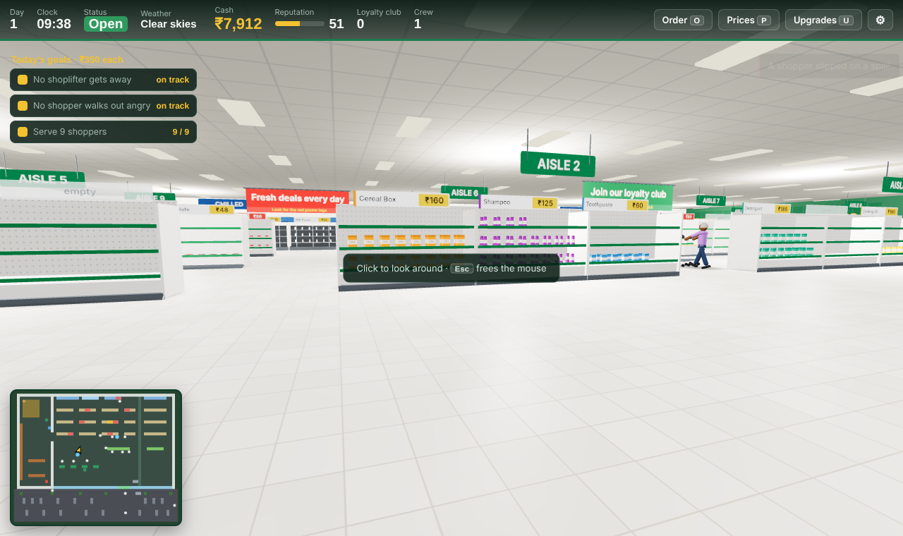
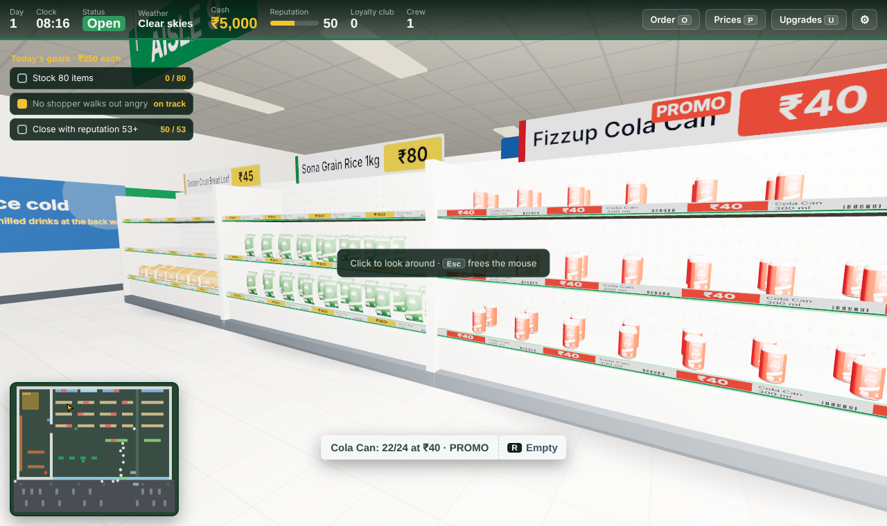

# MiniMart Mayhem

A first-person 3D **co-op supermarket** game for the browser. One machine runs the server,
everyone else opens a link in Chrome, Edge, Safari or on a phone. Up to **8 players**.

No npm install. No downloads for players. Three.js is bundled in `public/vendor/`.



---

## Run it

```bash
cd minimart
node server.js            # Node 16+ (the network test needs Node 22)
```

Everyone opens the address it prints, types a name, and presses *Start shift*.
Different port: `node server.js 9000`. `?name=Akshay` on the URL skips the name screen.

### Saving

- **When it saves:**
  - At the end of every day.
  - After each upgrade.
  - Every 2 minutes.
  - When you stop the server with Ctrl+C.
- **Where:** `saves/slot1.json` … `slot3.json`.
- **Host controls:** the **host** (whoever has been connected longest) can save, load a slot, or start a new game. It's in ⚙ Settings → Save slots. Everyone reloads into the new game automatically.
- **Starting over:** `MM_FRESH=1` ignores the save once, at start-up.

### Room password

```bash
MM_PASS=mysecret node server.js
```

Players type it in the *Room password* box on the join screen.

### Play over the internet

The server is LAN-first. To let friends join from elsewhere, use one of these:

1. **Tunnel (easiest, no router changes).**
   - Run a tunnel such as Cloudflare Tunnel: `cloudflared tunnel --url http://localhost:8080`.
   - Share the `https://….trycloudflare.com` link it prints.
   - The game switches to secure WebSockets automatically on https.
2. **Port forwarding.**
   - Forward TCP 8080 on your router to the server machine.
   - Share `http://<your public IP>:8080`.

Either way, set `MM_PASS` so strangers can't walk in. If anyone's connection drops, the client
reconnects on its own for about a minute.

### Running the server in a VM (VMware Ubuntu)

- Set the VM network adapter to **Bridged**, not NAT.
- Ignore any `172.x.x.x` address the server prints.
- If browsers still can't connect, run `sudo ufw allow 8080/tcp`.

---

## Controls

| Keyboard / mouse | Phone / tablet | Action |
|---|---|---|
| `W` `A` `S` `D` · `Shift` sprint | left stick · *Run* | Walk |
| Mouse (click to capture, `Esc` releases) | drag on the right half | Look |
| `E` / left-click | *Use* | Pick up · stock · mop · stop thief · bin a box · order terminal |
| `Q` / right-click | *Drop* | Drop the box you carry |
| `R` | *Empty* | Empty a fixture into a box (expired stock goes straight to waste) |
| `Space` (hold to repeat) | *Scan* (hold) | Scan at the till · ask for payment · open the cash drawer |
| `1`–`9` · `Backspace` · `Enter` | tap the notes | Cash drawer: add a note or coin · take one back · give change |
| `O` `P` `U` | *Order* *Prices* *Grow* | Supplier · prices & promotions · upgrades |
| `T` | *Chat* | Chat |
| `Tab` (hold) | *Crew* | Crew board |
| `M` · `H` | | Bigger minimap · help |
| `Enter` | *Open* | Open the store / continue to the next day |

---

## The world

- **Storage room:**
  - Delivery pad, pallet racking, order terminal.
  - **Waste bin**, notice board.
  - Supplier truck at the roller door.
- **Shop floor:** it grows with you, in four zones behind hoarding walls (see *Store levels*).
  - You start with a small **corner shop**: 8 shelves, 2 fridges, 2 produce stands and 2 tills by the door.
  - Fully grown: 56 shelves, 19 fridges, 4 chest freezers, 8 produce stands, 6 checkout lanes.
  - Hanging aisle signs and banners, section signs, a wall clock, posters.
  - Locked zones have "Coming soon" hoardings inside and whitewashed "Opening soon" windows outside.
  - Potted plants, basket stacks, a bench and a bin are solid: you walk round them, not through them.
- **Outside:**
  - Glass shopfront, sliding doors, lit sign, OPEN neon.
  - Car park with parked cars, trolley corral, trees and street lamps.
  - A road with traffic and a town across the street.
- **Time and weather:**
  - The store clock runs 08:00 to 22:00 with sunrise, dusk, night, moving clouds and stars.
  - Each day rolls clear, rain, festival or heatwave.

## Products and packaging

There are 36 products in 7 licensed product lines. Each has an invented brand, a real pack size and a price close to current Indian MRPs (2026).

**Example prices**

| Product | Pack size | MRP |
|---|---|---|
| Toned milk | 500 ml | ₹30 |
| Sandwich bread | 400 g | ₹45 |
| Atta | 5 kg | ₹355 |
| Cola | 300 ml | ₹40 |

The supplier sells at about 80% of MRP, which gives you roughly a 20% margin.

**What's printed on each pack**
- Front: brand, product name, an illustration, the pack size and the veg mark.
- Side: a nutrition (or directions) panel, a best-before line, MRP and a barcode.

**Pack shapes**

| Product | Shape |
|---|---|
| Cola | can |
| Shampoo, oil | bottle |
| Coffee | jar |
| Noodles | cup |
| Chips | crimped bag |
| Milk | pouch |
| Atta | sack |
| Juice | gable-top carton |
| Eggs | egg carton |
| Butter, paneer | block |
| Ice cream | tub |
| Pizza | box |

**Fruit and veg** are modelled pieces: apples with stems, tomatoes with leaves, onions, potatoes and banana bunches. Each piece is a slightly different shade.

**Shelf signage**
- Every shelf level has price tickets along its front edge.
- Promoted products get red tickets and a red OFFER sign.
- Expired stock gets grey tickets.

**Supplier cartons** carry the product artwork and the pack count.

All brands and artwork are original. No real company's logo or packaging is reproduced.



## How a day works

1. **Prep**: no clock.
   - Order stock, carry boxes from the yellow pad to the right fixture:
     - dry goods go on shelves
     - chilled goods go in fridges
     - frozen goods go in freezers
     - fruit and veg go in produce crates
   - Set prices and promotions, check today's three **goals** (top left).
   - Press `Enter` to open.
2. **Open**: shoppers arrive from the car park and the street, browse, and queue. There are regular, rushed, bulk (with a trolley) and loyalty-club shoppers.
   - Work a till (see *The checkout*).
3. **Trouble**:
   - **Thieves** get a red tag. Catch them with `E` and the goods drop as boxes.
   - **Spills** need three mops.
   - **Waiting too long**: impatient shoppers walk out.
   - **Low stock** and **sold out** warnings pop up for the crew.
4. **Overnight**: fresh food ages a day.
   - Bread, milk, eggs, paneer, yogurt, butter, juice, bananas, apples, tomatoes, onions and potatoes all have a shelf life.
   - **Expired** stock gets a grey tag and shoppers refuse it. Clear it with `R`, or throw expired boxes in the waste bin.
5. **Closing**: rent and wages are paid and goal bonuses are added. The receipt shows the books, the goals and the employee of the day.

### The checkout

Stand on the mat behind a till. A live bill appears on the right of the screen.

1. **Scan**: tap `Space` once per item. The bill lists each product with its quantity and price. A price is fixed the moment the item is scanned.
2. **Total**: after the last item, `Space` asks the shopper to pay.
3. **Payment**: the shopper chooses how to pay.
   - **Card**: they tap and enter a PIN. About 1 card in 14 is declined, and the shopper pays cash instead.
   - **UPI**: they scan the QR code on the customer display. It approves on its own.
   - **Cash**: they hand over notes, sometimes the exact money but usually a round amount (₹440, ₹450 or ₹500 for a ₹437 bill). `Space` opens the **cash drawer**. Count out the change with ₹500/200/100/50/20/10 notes and ₹5/2/1 coins (click them, or press keys `1`–`9`), then press `Enter`.
     - **Too little:** the shopper says how much is still owed, and your reputation drops a little.
     - **Too much:** the sale goes through, but the extra comes out of your cash.
4. **Receipt**: a printed slip shows the bill number, items, total, how it was paid, change and GST.

Until you buy the *Card & UPI machine*, every shopper pays cash. Hired cashiers do all of this on their own, and they always give the right change.

### Store levels

You start small. Each level costs cash and needs enough shoppers served (lifetime) and enough reputation. Buying it knocks down a hoarding wall and opens a new zone.

| Level | Store | Needs | Opens | Most shoppers a day |
|---|---|---|---|---|
| 1 | Corner Shop | – | 8 shelves, 2 fridges, 2 produce stands, tills 1–2 | 34 |
| 2 | Mini Market | ₹7,500 · 50 served | +10 shelves, 3 fridges, 2 produce stands, tills 3–4 | 60 |
| 3 | Supermarket | ₹20,000 · 180 served · reputation 55 | back hall: +20 shelves, a chilled wall (7 fridges), frozen aisle (4 freezers) | 92 |
| 4 | Superstore | ₹45,000 · 450 served · reputation 65 | east wing: +18 shelves, 7 fridges, 4 produce stands, tills 5–6 | 130 |

Rent rises with the store: ₹300, ₹700, ₹1,400 or ₹2,400 a day, plus ₹25 × the day number. Daily goals scale to what the current store can manage. The HUD badge shows your level and how close the next one is. Click it to open the panel.

### Product licences

A licence lets you order and sell a product line. Shoppers only ask for products you are licensed to sell.

| Licence | Level | Cost | Products |
|---|---|---|---|
| Daily essentials | 1 | free | bread, rice, cola, chips, soap, noodles, biscuits, milk, eggs, tomatoes, onions, potatoes |
| Kitchen staples | 1 | ₹1,200 | coffee, tea, cooking oil, atta |
| Personal care | 2 | ₹2,000 | shampoo, toothpaste, detergent |
| Dairy & fruit | 2 | ₹2,800 | paneer, yogurt, butter, bananas, apples |
| Breakfast & treats | 3 | ₹3,500 | cereal, chocolate, orange juice |
| Frozen foods | 3 | ₹5,000 | ice cream, frozen peas, frozen pizza |
| Premium & imported | 4 | ₹8,000 | lemon soda, dark chocolate, green tea, basmati 5 kg, mango drink, choco ice cream |

### Promotions, goals and loyalty

- **Promotions** (Prices panel, up to 3): a promoted product priced at or below what shoppers expect is wanted three times as often and sells an extra unit per basket.
- **Daily goals**: three per day, drawn from serving shoppers, sales, items stocked, no thefts, no walk-outs, no spills, reputation, promo sales and giving exact change. Each pays ₹250 + ₹100 × day; finishing all three adds reputation.
- **Loyalty club**: some happy shoppers sign up. Members wait longer, buy more, and bring more shoppers every day.

## Grow the store (`U`)

The panel has three parts: store levels, product licences, and equipment & staff.

| Equipment & staff | Level | Cost | Effect |
|---|---|---|---|
| Card & UPI machine | 1 | ₹1,200 | Shoppers can pay by card or UPI · 10% more shoppers |
| Fast barcode scanner | 1 | ₹1,800 | Every till scans 40% faster |
| Air conditioning | 1 | ₹1,500 | Shoppers wait 25% longer |
| CCTV + door alarm | 1 | ₹3,000 | Half the shoplifters, and they run slower |
| Express supplier | 2 | ₹2,500 | Deliveries arrive 60% faster |
| Radio ads | 2 | ₹2,000 | 25% more shoppers |
| Deep shelving | 3 | ₹6,000 | Every fixture holds 50% more |
| Hire a cashier (×3) | 1 | ₹1,800 / ₹2,600 / ₹3,600 | Works a free till alone, takes payment and gives change · ₹350/day |
| Hire a stock clerk (×3) | 1 | ₹2,500 / ₹3,400 / ₹4,500 | Carries boxes to shelves (skips expired ones) · ₹450/day |

**Older saves** (from before store levels) load straight in. The level is worked out from the old upgrades: east wing → Superstore, frozen aisle or till 4 → Supermarket, till 3 → Mini Market. You get every licence up to that level. The floor plan has changed, so stock that was on the shelves comes back as boxes in the storage room.

## Settings (⚙)

- Mouse sensitivity, invert Y, field of view (60–95°), head bob on/off.
- Sound-effect and music volume. The music is generated live in the browser; there are no audio files.
- Graphics:
  - **Low** – older laptops.
  - **Medium**.
  - **High** – adds sun shadows.
- **Automatic resolution** (on by default): renders at lower resolution while the game stutters and goes back up when it recovers.

## Tuning

```bash
MM_DAY=180         # seconds the store is open (default 300)
MM_CASH=20000      # starting cash (default 5000)
MM_SERVED=50       # start a new game as if this many shoppers were already served (try level-ups early)
MM_DELIVERY=3      # delivery time in seconds (default 9)
MM_CLOSE=20        # grace period after closing (default 50)
MM_PASS=secret     # room password
MM_FRESH=1         # ignore the save on start-up
MM_SAVE=off        # don't save at all
MM_SAVE_DIR=/path  # where save slots live (default ./saves)
MM_DEMO=1          # pre-stocked, already-open store for testing (no saving)
```

---

## Tests

```bash
# 1. simulation - 163 checks, ~15 s, no server needed
node test/game.test.js

# 2. multiplayer over real WebSockets - 35 checks: password, licences, a level-up, a full day with cash change, slots, reconnects
MM_SAVE_DIR=/tmp/mm-test MM_FRESH=1 MM_PASS=letmein MM_DAY=75 MM_CLOSE=20 MM_DELIVERY=2 MM_CASH=40000 MM_SERVED=50 node server.js 8099 &
PASS=letmein PORT=8099 node test/bots.js

# 3. real Chrome: two desktop windows and a phone - 35 checks (needs playwright)
MM_SAVE=off MM_DEMO=1 MM_DAY=900 node server.js 8099 &
PORT=8099 node test/ui.js

# 4. real Chrome play-through - 14 checks: stock a shelf, bump into a plant, give cash change, receipt
MM_SAVE=off MM_DEMO=1 MM_DAY=900 node server.js 8099 &
PORT=8099 node test/play.js
```

## How it's built

```
server.js         static files (gzip + ETag), RFC6455 WebSocket, password, flood guard,
                  save slots + host controls, 30 Hz simulation, 15 Hz snapshots
game.js           the simulation: zoned map, store levels, licences, fixtures, economy,
                  shoppers, checkout + payments, staff, upgrades, promotions, goals,
                  loyalty, expiry, collision, save/load
public/client.js  input (mouse, keyboard, touch), prediction, HUD, live bill, cash drawer,
                  receipts, panels, minimap, chat, generated music and sound,
                  auto-resolution, reconnect
public/scene.js   Three.js world: building, outdoors, sky, lighting, products, crowd
public/packaging.js  printed pack artwork, pack shapes, produce models, supplier cartons
public/props.js   detailed static props: potted plants, street trees, cars, checkout
                  counters, fridge/freezer trim, produce stands, baskets, ceiling fittings
```

### Performance

- **Files:** gzipped once and cached by the browser. three.js goes over the wire at 170 KB instead of 687 KB.
- **Static world:** merged into one mesh per material.
- **Products:** instanced, one draw call per product.
- **People:** every player, shopper and staff member is drawn with ~24 instanced meshes in total, so a full store costs the same as an empty one. Limbs are posed on the CPU.
- **Shadows under moving things:** one instanced draw.
- **Snapshots:** the server serialises each snapshot once per tick and only appends the per-player prompt. Shoppers are packed as flat arrays (about 35% smaller).
- **Flow control:** browsers acknowledge each snapshot they apply, and the server keeps at most a few in flight per player. A slow phone, a busy loading screen or a background tab never builds up seconds of stale snapshots to replay; events from skipped snapshots are still delivered.
- **Lights:** a few strong ceiling lights per zone; lights of locked zones are dimmed, not removed, so shaders are never recompiled at a level-up.
- **Loading:** the world builds in steps behind a progress bar, and shaders are compiled before the first frame.

Everything is built from primitives and canvas textures at runtime. There are no image, model or
audio files.
